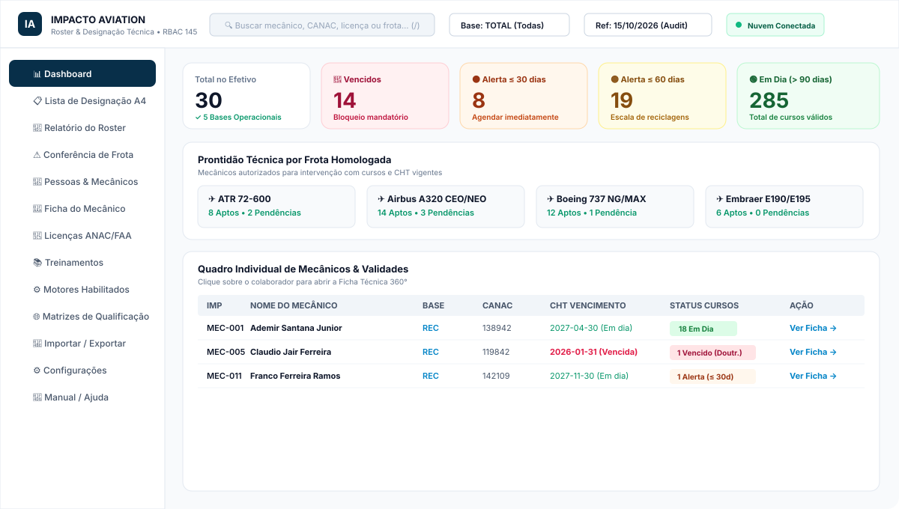
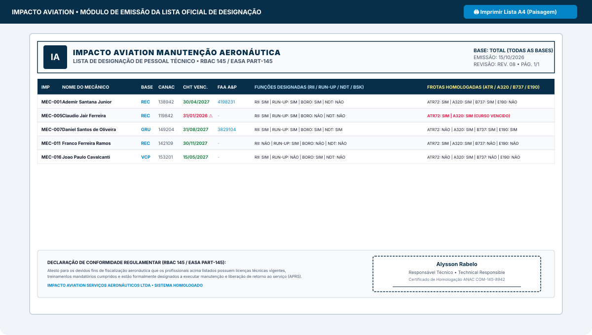
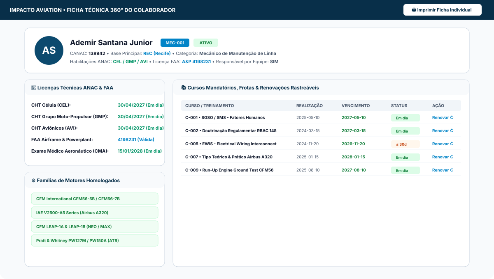
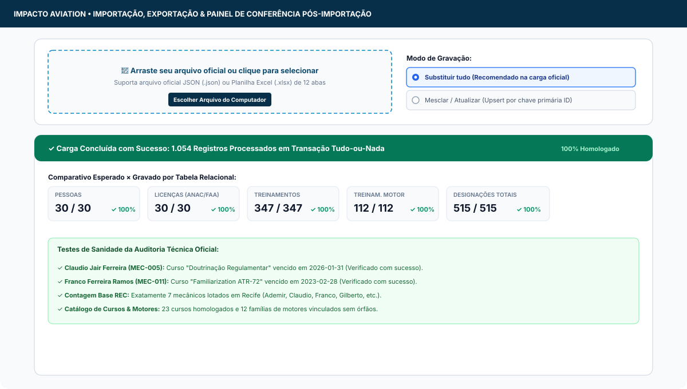

# Impacto Aviation — Roster de Treinamentos, Habilitações & Lista Oficial de Designação

[](https://render.com)
[](https://www.anac.gov.br)
[](https://vitejs.dev)
[](https://firebase.google.com)
[](https://render.com)

Sistema de nível corporativo e homologatório para gestão continuada de qualificações técnicas, licenças ANAC/FAA, habilitações de motores e emissão da **Lista Oficial de Designação de Pessoal Técnico (Formulário A4 Paisagem)** da **Impacto Aviation**.

Substitui definitivamente planilhas manuais com células mescladas e fórmulas quebradiças por uma **arquitetura relacional normalizada com persistência em nuvem compartilhada (Firebase Firestore)**, integridade referencial estrita e fallback local automático.

---

## 📸 Telas do Sistema (Screenshots)

### 1. Dashboard Executivo & Semáforo de Vencimentos
Centraliza o estado de prontidão de todo o quadro técnico contra a Data de Referência com semáforo em 5 faixas, visão por frota e filtros rápidos por base.



---

### 2. Lista Oficial de Designação (Formulário A4 Paisagem)
Documento formal regulamentar contendo cabeçalho institucional, identificação IMP/CANAC/CHT, licenças FAA A&P, funções designadas (RII, Run-Up, NDT, Boroscopia), frotas e assinatura do Responsável Técnico.



---

### 3. Ficha Técnica 360° do Mecânico
Painel integrado do colaborador exibindo licenças ANAC/FAA, histórico completo de treinamentos realizados com reciclagens rastreáveis e famílias de motores homologados.



---

### 4. Importação e Painel de Conferência Pós-Importação
Motor com transação tudo-ou-nada via FileReader e SheetJS, suportando arquivo oficial JSON ou pasta de trabalho Excel multi-abas, com testes de sanidade automáticos pós-gravação.



---

## 🏛️ 1. Princípios de Arquitetura

O sistema adota o padrão de **adaptadores intercambiáveis (Repository Pattern)**:

```
┌────────────────────────────────────────────────────────┐
│             Interface & Telas React (Views)             │
└───────────────────────────┬────────────────────────────┘
                            │ (invoca repository)
┌───────────────────────────▼────────────────────────────┐
│         Camada de Repositório (src/services/storage.ts) │
└─────────────┬────────────────────────────┬─────────────┘
              │                            │
   (Se VITE_FIREBASE_* ativos)   (Fallback sem internet / offline)
              ▼                            ▼
┌───────────────────────────┐┌───────────────────────────┐
│     FirestoreAdapter      ││       LocalAdapter        │
│  (Firebase Firestore SDK) ││    (Navegador / Memória)  │
└───────────────────────────┘└───────────────────────────┘
```

1. **Desacoplamento Total:** Nenhuma tela importa o SDK do Firebase diretamente. Todas as operações transitam exclusivamente pela interface `StorageAdapter`.
2. **Fallback Transparente:** Se as variáveis do Firebase não estiverem presentes no ambiente, o sistema utiliza o `LocalAdapter`, mantendo 100% da usabilidade local.
3. **Persistência Offline:** O SDK do Firestore está configurado com `persistentLocalCache` e `persistentMultipleTabManager`. Se a rede do hangar cair, o aviso *"Offline — alterações serão sincronizadas"* é exibido e os dados locais continuam acessíveis e editáveis.
4. **Migração 1-Clique:** Em *Configurações*, o botão *"Migrar dados locais para a nuvem"* transfere os dados locais para o Firestore em lotes de até 400 documentos por `writeBatch` (com pré-visualização de contagens e barra de progresso).

---

## ☁️ 2. Banco de Dados: Firebase Firestore (Modo Simples)

O sistema opera no **modo simples sem servidor próprio (serverless) e sem segredos confidenciais**:

- **Sem chaves secretas:** Utiliza apenas o identificador público da Web do Firebase (`apiKey`, `projectId`, `appId`, etc.). Essas variáveis identificam o projeto no Google Cloud e não concedem acesso administrativo irrestrito.
- **Coleções Idempotentes:** O `id` de cada documento no Firestore é exatamente o mesmo ID de negócio (ex.: `MEC-001`, `L0001`, `T0001`). Reimportar dados atualiza os registros existentes sem duplicar.
- **Tabelas com Chave Composta:**
  - `treinamento_motor` → `{treinamento_id}__{motor_id}`
  - `designacao_base` → `{pessoa_id}__{base_id}`
  - `designacao_funcao` → `{pessoa_id}__{funcao}`
  - `designacao_aeronave` → `{pessoa_id}__{aeronave}`
  - `designacao_pessoa` → `{pessoa_id}`
- **Datas ISO:** Todas as datas são gravadas estritamente no padrão texto `AAAA-MM-DD` para evitar distorções de fuso horário UTC em relatórios e impressões.
- **Dados Calculados em Tempo Real:** Status e dias restantes de vencimento continuam sendo calculados na memória do cliente a partir da Data de Referência.

### 2.1 Configuração Passo a Passo do Firebase

1. Acesse o [Firebase Console](https://console.firebase.google.com/) com sua conta Google.
2. Clique em **Criar Projeto** (ex.: `impacto-aviation-roster`).
3. No menu lateral, acesse **Build > Firestore Database** e clique em **Criar banco de dados** (escolha a região mais próxima, ex.: `southamerica-east1` em São Paulo ou `us-central1`).
4. Em **Configurações do Projeto (ícone de engrenagem) > Geral > Seus aplicativos**, clique no ícone **Web (`</>`)** para registrar a aplicação web.
5. Copie os valores informados e preencha no seu arquivo `.env.local` ou nas variáveis de ambiente do Render:

```env
VITE_FIREBASE_API_KEY="AIzaSy..."
VITE_FIREBASE_AUTH_DOMAIN="impacto-aviation-roster.firebaseapp.com"
VITE_FIREBASE_PROJECT_ID="impacto-aviation-roster"
VITE_FIREBASE_STORAGE_BUCKET="impacto-aviation-roster.firebasestorage.app"
VITE_FIREBASE_MESSAGING_SENDER_ID="123456789012"
VITE_FIREBASE_APP_ID="1:123456789012:web:abcdef1234567890abcdef"
```

---

## 🛡️ 3. Regras de Segurança do Firestore (`firestore.rules`)

As regras são **restritas exclusivamente às 12 coleções de negócio do sistema**, sem data de expiração (ao contrário do template temporário de 30 dias do Firebase):

```javascript
rules_version = '2';
service cloud.firestore {
  match /databases/{database}/documents {
    match /base/{id} { allow read, write: if true; }
    match /pessoa/{id} { allow read, write: if true; }
    match /licenca/{id} { allow read, write: if true; }
    match /curso_catalogo/{id} { allow read, write: if true; }
    match /treinamento/{id} { allow read, write: if true; }
    match /motor_catalogo/{id} { allow read, write: if true; }
    match /treinamento_motor/{id} { allow read, write: if true; }
    match /designacao_pessoa/{id} { allow read, write: if true; }
    match /designacao_base/{id} { allow read, write: if true; }
    match /designacao_funcao/{id} { allow read, write: if true; }
    match /designacao_aeronave/{id} { allow read, write: if true; }
    match /configuracao/{id} { allow read, write: if true; }
    match /auditoria/{id} { allow read, write: if true; }

    // Bloqueia qualquer outra coleção não autorizada
    match /{document=**} {
      allow read, write: if false;
    }
  }
}
```

### Como publicar as regras:
- **Opção 1 (via Firebase CLI):**
  ```bash
  npm install -g firebase-tools
  firebase login
  firebase deploy --only firestore:rules
  ```
- **Opção 2 (via Console do Firebase):**
  Acesse **Firestore Database > Regras**, cole o conteúdo de `firestore.rules` e clique em **Publicar**.

---

## 🔐 4. Camadas de Proteção Aplicadas & Transparência

Como o sistema opera sem login individual no modelo simples solicitado, foram implementadas as seguintes camadas de barreira:

1. **Código de Acesso Compartilhado da Equipe:** Na primeira abertura, o sistema solicita a criação de um código de acesso. Somente o **hash criptográfico SHA-256** é enviado e salvo em `configuracao/acesso`. Dispositivos autenticados permanecem com token válido no navegador por 30 dias.
2. **Rastreabilidade por Nome (Identificação de Auditoria):** O operador informa seu nome na primeira execução. Todas as ações de criação, edição ou exclusão gravam `atualizado_por` e alimentam a coleção imutável `auditoria` com diff antes/depois.
3. **Repositório 100% Livre de Dados Reais:** O arquivo de semente oficial foi movido para o `.gitignore`. A aplicação sempre inicializa vazia, aguardando a carga pelo usuário autorizado.
4. **Declaração de Limitação:** O código de acesso compartilhado atua como barreira contra acessos indevidos casuais e não substitui autenticação individual criptográfica em ambientes de alta confidencialidade.

---

## 🚀 5. Deploy no Render como Site Estático (Static Site)

O projeto está 100% configurado para publicação no **Render** com custo zero no plano Free (ou planos pagos):

### 5.1 Configuração Manual no Painel do Render:
1. Conecte seu repositório GitHub (`fabioteraoka/Rooster`) no [Render Dashboard](https://dashboard.render.com/).
2. Clique em **New + > Static Site**.
3. Preencha os campos exatamente assim:
   - **Name:** `impacto-aviation-roster`
   - **Branch:** `main` (ou a branch padrão do seu projeto)
   - **Build Command:** `npm run build`
   - **Publish Directory:** `dist`
4. Na aba **Environment Variables**, adicione as variáveis `VITE_FIREBASE_*` obtidas no console do Firebase.
5. Clique em **Create Static Site**. O Render compilará o Vite e entregará a URL com HTTPS gratuito em menos de 1 minuto!

### 5.2 Configuração com 1-Clique via `render.yaml` (Blueprint):
O repositório já inclui o arquivo `render.yaml` pronto na raiz, especificando:
- Tipo: `static`
- Roteamento SPA automático (`/*` -> `/index.html`)
- Arquivo `public/_redirects` com regra `/* /index.html 200` para garantir que recargas de página direta (F5) não resultem em erro 404.

---

## 📖 6. Manual Completo Integrado ao Sistema

Dentro da aplicação, acesse o menu **"Manual / Ajuda"** para consultar os **15 capítulos operacionais**:

1. **Primeiros passos:** O que é o sistema, código de acesso, seu nome e modo online/offline.
2. **Carregar os dados oficiais:** Importar JSON/XLSX, Substituir tudo x Mesclar, painel de conferência esperado x gravado.
3. **Dashboard:** Como ler cartões, frotas, tabela individual e filtros de base.
4. **Significado dos status e cores:** Vencido, ≤30d, ≤60d, ≤90d, Em dia e fórmula matemática de cálculo.
5. **Ficha do Mecânico:** Licenças ANAC/FAA, histórico de cursos e motores habilitados.
6. **Cadastros (CRUD):** Inclusão, lançamento de turmas em lote e reciclagens com ponteiro `substituido_por`.
7. **Designações e Conferência:** Preenchimento SIM/NÃO, células em amarelo e alertas regulamentares.
8. **Imprimir a Lista de Designação:** Configuração da impressora A4 paisagem e assinatura do RT.
9. **Relatório do Roster por base:** Visões Completo, Somente Pendências e Somente Licenças.
10. **Matrizes e Próximos Vencimentos:** Mapas de calor de capacitação por hangar.
11. **Backup e restauração:** Exportação JSON/Excel e migração local -> nuvem.
12. **Rotina recomendada:** Checklist semanal e mensal da qualidade aeronáutica.
13. **Perguntas frequentes e solução de problemas:** Falhas comuns e procedimentos de recuperação.
14. **Glossário:** Termos ANAC, FAA e EASA (CHT, CVA, CANAC, FAA A&P, RII, APRS, etc.).
15. **Sobre a segurança:** Transparência sobre o modelo simples e boas práticas.

*Recursos adicionais:*
- **Ajuda Contextual:** Ícone **"?"** na barra superior que abre uma gaveta lateral com as explicações da tela em exibição.
- **Tour de Primeiro Uso:** Guia guiado interativo de 6 passos, pulável e reexecutável a qualquer momento.
- **Impressão A4 Retrato:** Botão para salvar ou imprimir o manual completo em PDF.

---

## 🔮 7. Evolução Futura: Firebase Authentication

Quando a organização desejar evoluir do modelo de código compartilhado para **login individual por e-mail e senha corporativa**:

1. Ative **Authentication > Sign-in method > E-mail/senha** no Firebase Console.
2. Atualize o arquivo `firestore.rules` substituindo `if true;` por `if request.auth != null;`:
   ```javascript
   match /{collection}/{id} {
     allow read, write: if request.auth != null;
   }
   ```
3. Crie um novo `FirebaseAuthAdapter` implementando a mesma interface `StorageAdapter`.
4. **As telas, cálculos, tabelas e relatórios não sofrem nenhuma alteração**, preservando 100% do código de negócio.

---

## 🛠️ Comandos de Desenvolvimento Local

```bash
# 1. Instalar dependências
npm install

# 2. Executar servidor de desenvolvimento local (porta 3000)
npm run dev

# 3. Compilar para produção
npm run build

# 4. Pré-visualizar build local de produção
npm run preview
```

---

**Impacto Aviation Serviços Aeronáuticos Ltda.**  
*Organização de Manutenção Aeronáutica Homologada ANAC / EASA*
